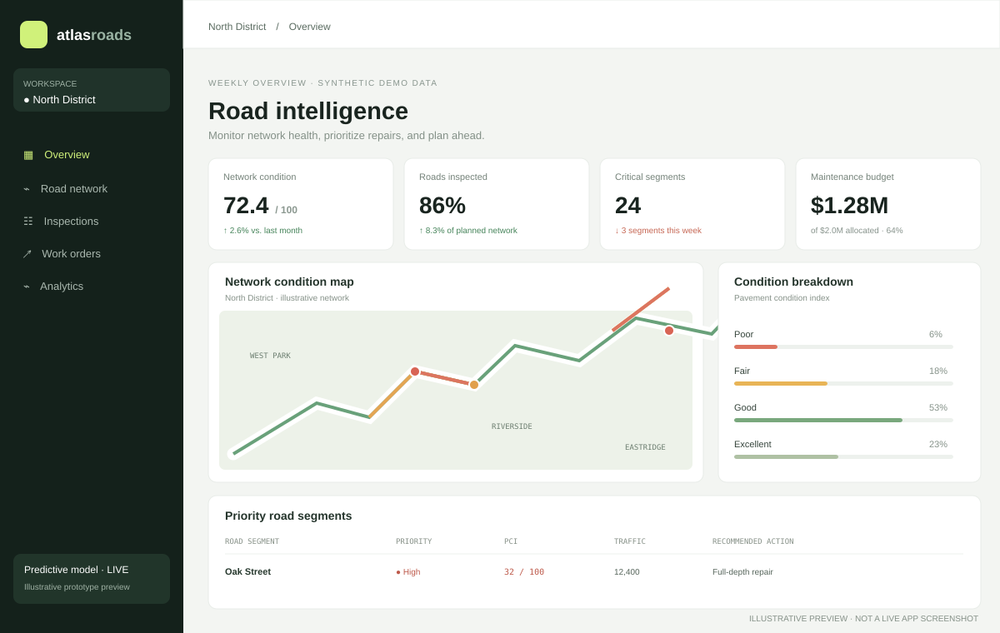
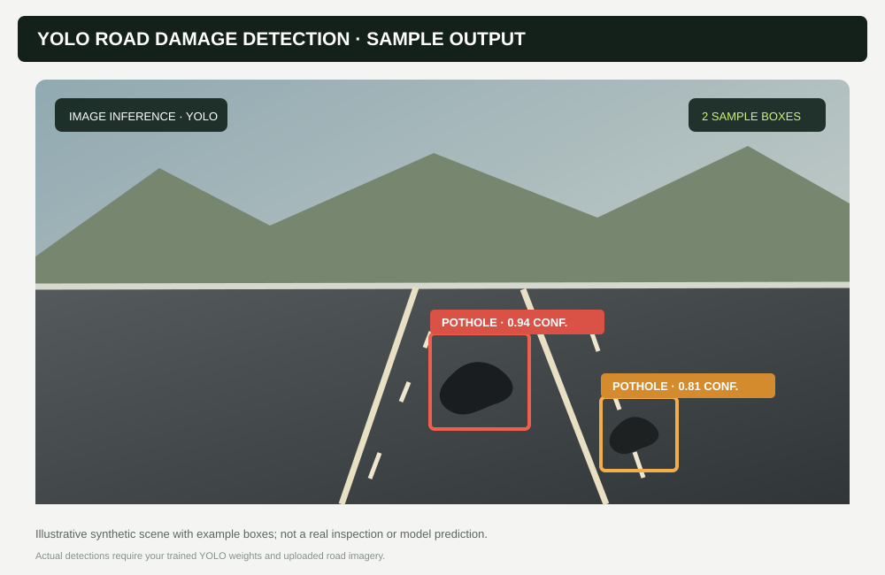

# Intelligent Road Condition Assessment and Predictive Maintenance Platform

## Run locally
Python 3.11+ is required. From the repository root:

```powershell
py -m venv .venv
.\.venv\Scripts\Activate.ps1
pip install -r requirements.txt
pip install -e .
Copy-Item .env.example .env
python -m road_platform.cli all
uvicorn road_platform.api:app --reload
```
Open API docs at `http://localhost:8000/docs`. In another terminal run `streamlit run src/road_platform/dashboard.py`.

`python -m road_platform.cli data` creates a deterministic **synthetic prototype dataset** when the configured CSV is absent. The generated records and outcomes are simulated and are not field measurements; model metrics from this data are only pipeline checks. Supply a real CSV with `segment_id,pci,rainfall_mm,traffic_count,historical_damage_count,observed_at`, plus `future_pci,horizon_days` labels for each supervised prediction horizon, before interpreting model performance operationally. YOLO is optional and requires a separately trained, authorized weights file configured with `YOLO_WEIGHTS`; no pretrained road-damage weights are bundled.

## Commands

```powershell
python -m road_platform.cli data     # load or generate data, then clean
python -m road_platform.cli eda      # summary and reports/eda.html
python -m road_platform.cli train    # severity RF, horizon RFs, XGBoost comparison
python -m road_platform.cli all      # end-to-end data, EDA, and training
pytest -q
```

Use `--real-only` with `data`, `eda`, `train`, or `all` to refuse automatic synthetic data generation. Training writes serialized models under `models/` and reports actual held-out MAE, RMSE, R², and severity metrics; it does not print canned evaluation scores.

## PostgreSQL and Docker
The SQLAlchemy mapping creates `road_segments` and `predictions`; `db_schema.sql` is the equivalent explicit PostgreSQL schema. `docker compose up --build` starts PostgreSQL, API, and Streamlit. Configure credentials with environment variables in deployment; compose defaults are development-only.

## APIs
- `GET /health` — database connectivity.
- `GET /segments?limit=500` — persisted road segments.
- `POST /segments` — create/update one observation.
- `POST /segments/{id}/predict?horizon=7|15|30` — run horizon model and persist the forecast.
- `GET /segments/{id}/predictions` — persisted forecast history.

The included tests cover data generation/cleaning, feature engineering, risk scoring, and route registration. YOLO requires image data and suitable weights and is deliberately not fabricated or downloaded.

## Preview images

These illustrations show the intended dashboard and YOLO detection result layout. They are **not screenshots or actual model outputs**; the demo values are illustrative.




